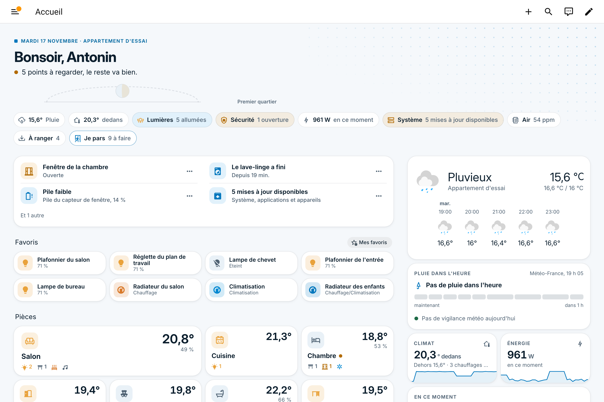

# Automatic Dashboard

Automatic Dashboard is a complete Home Assistant dashboard that builds itself from your areas, floors and devices. Nothing to write, nothing to configure: when you add a device or a room, the dashboard follows.
It adapts to the size of the home, from three devices to several hundred, keeps one visual identity in light and dark, and never contacts any external service.

It is a free, non-profit community project, started by Antonin Chenavaz. The interface is available in English and French.

Everything else is on the website: [automatic-dashboard.github.io](https://automatic-dashboard.github.io/en/), with the demo and the documentation.

## Install

You need Home Assistant 2026.9 or newer.

1. Open the Marketplace: *Settings*, *Marketplace*. The first time, accept the warning.

   

2. In the top right corner, *Add from link*, then `Automatic-Dashboard/automatic-dashboard`. The first time, the Marketplace asks you to connect GitHub with a code to approve on github.com.
3. Open Automatic Dashboard, then *Install*. The integration screen opens: keep *Create the dashboard* ticked, and tick *Make it the default dashboard* if you like.
4. Reload the page: the dashboard is in the sidebar.

With Home Assistant 2026.9 or 2026.10, install it from HACS: [open Automatic Dashboard in HACS](https://my.home-assistant.io/redirect/hacs_repository/?owner=Automatic-Dashboard&repository=automatic-dashboard&category=integration), *Download*, restart Home Assistant, then [add the integration](https://my.home-assistant.io/redirect/config_flow_start/?domain=automatic_dashboard).

Every step, the settings and the frequently asked questions are in [the documentation](https://automatic-dashboard.github.io/en/documentation/).

## Contributing

A misplaced device, a bug, an idea: [open an issue](https://github.com/Automatic-Dashboard/automatic-dashboard/issues/new/choose). The [contributing guide](.github/CONTRIBUTING.md) explains how to attach the diagnostic of your home, without any name or value, and how to propose code. What comes next is in the [roadmap](https://github.com/Automatic-Dashboard/automatic-dashboard/milestones). Issues and pull requests are welcome in English or French.

## License

The code is under the Apache 2.0 license: see [LICENSE](LICENSE). The Automatic Dashboard name, logo and symbol remain reserved: see [NOTICE](NOTICE). The Inter typeface keeps its license (SIL Open Font License 1.1).

Home Assistant is a trademark of the Open Home Foundation. Automatic Dashboard is not affiliated with it.

---

## En français

Automatic Dashboard est un tableau de bord complet pour Home Assistant, qui se construit tout seul à partir de vos pièces, de vos étages et de vos appareils. Rien à écrire, rien à configurer : quand vous ajoutez un appareil ou une pièce, le tableau suit. C'est un projet communautaire et libre, sans but lucratif, initié par Antonin Chenavaz.

**Installer** (Home Assistant 2026.9 ou plus récent) : dans *Paramètres*, *Marketplace*, choisissez *Ajouter grâce à un lien* et tapez `Automatic-Dashboard/automatic-dashboard`, puis *Installer*. L'écran de l'intégration s'ouvre : laissez *Créer le tableau* cochée, puis rechargez la page. Avant Home Assistant 2026.11, passez par [HACS](https://my.home-assistant.io/redirect/hacs_repository/?owner=Automatic-Dashboard&repository=automatic-dashboard&category=integration) et [ajoutez l'intégration](https://my.home-assistant.io/redirect/config_flow_start/?domain=automatic_dashboard).

Tout le reste est sur [le site](https://automatic-dashboard.github.io), dont [la documentation](https://automatic-dashboard.github.io/documentation/). Pour signaler un appareil mal rangé ou proposer du code : le [guide de contribution](.github/CONTRIBUTING.md) ; la suite est dans la [feuille de route](https://github.com/Automatic-Dashboard/automatic-dashboard/milestones).
